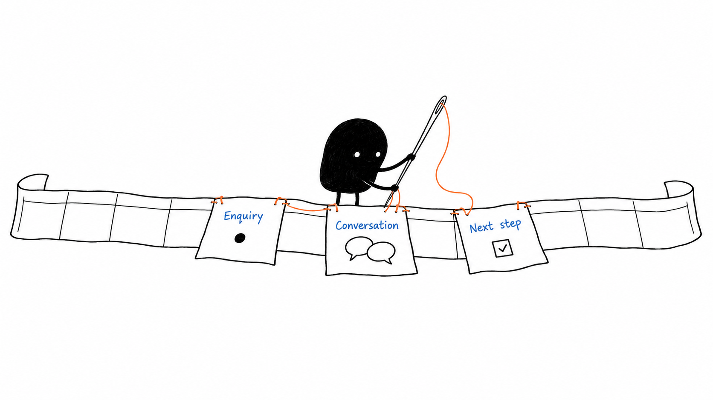
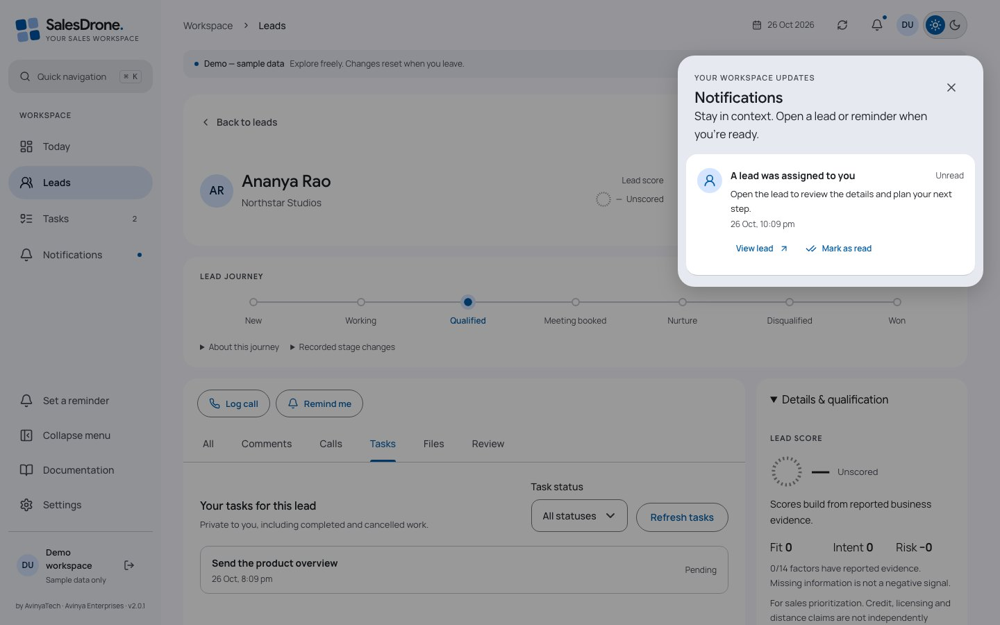
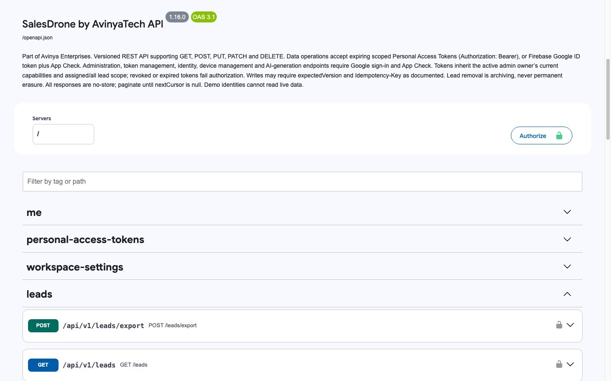

# SalesDrone by AvinyaTech

[](https://github.com/theharithsa/SalesDrone/actions/workflows/deploy.yml)
[](https://github.com/theharithsa/SalesDrone/releases/latest)
[](LICENSE)
[](https://theharithsa.github.io/SalesDrone/)
[](https://sales-drone-avinya.firebaseapp.com/api/docs)

[](https://firebase.google.com/)
[](https://react.dev/)
[](https://www.typescriptlang.org/)
[](https://nodejs.org/)
[](https://ai.google.dev/)

**Part of Avinya Enterprises · v1.6.3 · MIT**

A sales workspace that keeps an enquiry, its conversations and its next step together. Built with React, Firebase and Gemini, with a responsive interface for desktop and mobile.

[Open SalesDrone](https://sales-drone-avinya.firebaseapp.com) · [Illustrated guide](https://theharithsa.github.io/SalesDrone/) · [Releases](https://github.com/theharithsa/SalesDrone/releases) · [Deployment workflow](https://github.com/theharithsa/SalesDrone/actions/workflows/deploy.yml)


## Why SalesDrone

For a small business, the hard part is often keeping track of the conversation behind each spreadsheet row. SalesDrone helps founders, SDRs and small teams carry that context from the first enquiry to the next follow-up. AI provides a starting point for reminders and priorities; people stay in control of the relationship.



We currently use SalesDrone internally and shape it around everyday work. More modules are planned as that experience grows. Read [our story and mission](https://sales-drone-avinya.firebaseapp.com/settings?section=about) in Settings → About SalesDrone; the demo includes it too.

## From enquiry to follow-through

Import the first Excel worksheet or CSV, map the fields, and select several discussion columns to become separate timeline comments; historical discussion dates remain unknown rather than being invented. New enquiries then arrive through the form. Search and combine column filters, edit a lead, record a call, and keep its comments in one timeline.

A lead’s journey highlights its current stage and lists recorded stage changes. The dashboard funnel is a snapshot of current counts: selecting a stage opens its filtered leads. Its widths do not claim conversion rates or an invented history.


Gemini analyzes new call comments and lead notes for actionable follow-ups. Eligible reminders become tasks with visible dates and Edit/Undo; ambiguous instructions request clarification. Manual reminders, task editing, deletion, snoozing and completion remain available. On-demand dashboard AI summaries and configurable evidence-based scores help prioritize outreach; scores do not independently verify credit, licensing or distance claims.

The notification bell opens an overlay without losing your place. Assignment and reminder notifications support read/unread state and browser push. Delivery still depends on browser permission, a registered device and platform support.



<details>
<summary>Mobile lead view</summary>


</details>

## Access and configuration

Google sign-in establishes identity; server-side membership and capabilities determine access. Unapproved users see an isolated synthetic demo, never live leads. Administrators manage people and permissions, field definitions and built-in names, dropdown options, dashboard AI instructions, scoring factors and workspace preferences in Settings. Protected bootstrap administrators are defined in server configuration.

The repository contains application code and reviewed synthetic screenshots. It contains no imported customer workbook, production lead export, private credentials or production screenshots. Public Firebase browser configuration is an identifier, not an authorization boundary. Firestore client access is denied; the authenticated API enforces permissions and lead scope.

## Run locally

Use Node **22.18+ within Node 22 LTS**, npm, and Java **21** for the Firestore emulator. The deployed backend runs Node 22.

```sh
npm ci
npm test
npm run check
npm run build
npm run dev
```

Select **Explore the demo** to preview without production credentials. For the local backend:

1. Copy `functions/.env.example` to `functions/.env.local`.
2. Run `npm run emulators` against **demo-salesdrone**.
3. Copy `apps/web/.env.example` to `apps/web/.env.local`, set `VITE_USE_EMULATORS=true`, and run `npm run dev`.
4. Use the Auth emulator’s simulated Google sign-in. Never point disposable test fixtures at production.

An unavailable live API produces an error; it does not silently replace a live workspace with demo data.

## API integrations

[Open the Swagger API portal](https://sales-drone-avinya.firebaseapp.com/api/docs) for all supported read, create, update and delete operations. Admins can generate expiring, scoped **Personal Access Tokens** in **Settings → Developer settings**. Tokens are shown once, stored as hashes and revocable. They inherit current owner permissions and cannot administer people, security settings or other tokens.



See the [API integration guide](docs/API.md) for scopes, CRUD examples, pagination, concurrency, errors and rotation. The portal is self-hosted on Firebase with no analytics or third-party JavaScript.

## Stack and technical documentation

| Layer               | Technology                                                                                    |
| ------------------- | --------------------------------------------------------------------------------------------- |
| Interface           | React 19, TypeScript, Vite, Radix Dialog, Lucide icons, custom SVG charts, responsive CSS     |
| Identity and access | Firebase Google Authentication, App Check, server-enforced capabilities                       |
| API and data        | Node.js 22 Cloud Functions, versioned HTTP API, Firestore transactions and indexes            |
| Follow-ups          | Gemini, durable note analysis, scheduled reminder workers, Firebase Cloud Messaging           |
| Monitoring          | Dynatrace browser RUM, OpenTelemetry traces/logs/metrics, transactional BizEvent outbox       |
| Delivery            | GitHub Actions, Google Workload Identity Federation, Firebase Hosting/Functions, GitHub Pages |

- [Technical architecture and data flow](docs/TECHNICAL.md)
- [Module skills for future agents](skills/README.md) — 18 service playbooks with code, API, test and deployment boundaries
- [Swagger portal](https://sales-drone-avinya.firebaseapp.com/api/docs) and [API integration guide](docs/API.md)
- [Versioned OpenAPI contract](docs/openapi.json)
- [Automatic reminders](docs/AUTOMATIC-REMINDERS.md) and [intelligence/scoring](docs/INTELLIGENCE.md)
- [Workbook mapping](docs/WORKBOOK-ALIGNMENT.md)
- [Observability contract and verification limits](docs/observability.md)
- [Release process, deployment and rollback](docs/RELEASE.md)
- [Security policy](SECURITY.md), [contributor/agent instructions](AGENTS.md), [third-party notices](THIRD-PARTY-NOTICES.md)

The automated checks cover domain policy, scoped access, imports, reminders, stage history and telemetry resilience, including independent decoding of actual OTLP protobuf. Firestore/Auth emulator integration exercises real queries and transactions. See the workflow for the exact checks and release evidence. An accepted monitoring request does not prove tenant searchability or native RUM-to-trace navigation.

## Releases

Main-branch pushes run verification, deploy Firestore indexes/rules, wait for indexes, deploy Cloud Functions and Hosting, check published commit metadata, and send the deployment result and version to Dynatrace. A separate job publishes only the curated documentation site. Cloud authentication uses short-lived OIDC credentials; ingestion credentials stay in Secret Manager and GitHub Actions secrets.

The initial release was **v1.0.0**. Subsequent changes use `npm run release -- patch`, `minor` or `major`, fill the dated [changelog](CHANGELOG.md), and commit the resulting version files. The workflow rejects version regressions or unchanged release versions on subsequent pushes. API contract versions are independent of app versions.

## Licence and illustrations

Application code is released under the [MIT licence](LICENSE), copyright Avinya Enterprises. Brand names and logos remain their owners’ marks. Font and dependency licences are documented in [third-party notices](THIRD-PARTY-NOTICES.md).

The About story, README and public guide include original generated illustrations made using the [Ian Xiaohei illustration workflow](https://github.com/tojileon/ian-xiaohei-illustrations-en). Their [review manifest](assets/salesdrone-guide-illustrations/QA.md) accompanies the source images. Product screenshots use synthetic demo data; the API portal image shows only public schemas.

Filtered Excel reports are available directly in Leads, with a column picker and the same applied filters across all matching pages. Admins control report availability and non-admin assigned-only access under Settings → Reports & lead access. See [report behavior and limits](docs/REPORTS.md).

Read the [complete settings guide](docs/SETTINGS.md) or its [published version](https://theharithsa.github.io/SalesDrone/settings.html) for every control, default, permission and environment boundary. Agent routing: [skill-tree.json](skill-tree.json) / [skill-tree.md](skill-tree.md). Every feature release follows the [completion and deployment checks](skills/salesdrone-release-readiness/SKILL.md).

The [lead overlay](docs/LEAD-BLADE.md) can be resized on desktop without changing the table. Open full lead page for All, Comments, Calls, Tasks and Review tabs at a bookmarkable URL. Wider journeys run horizontally; stage/assignment stay at the top. Keyboard resizing, aligned fluid navigation and reduced-motion preferences are supported.

## Product handbook

Read the [complete product handbook](https://theharithsa.github.io/SalesDrone/product.html) for module workflows, permissions, troubleshooting and FAQs. The [full settings reference](https://theharithsa.github.io/SalesDrone/settings.html) explains every control. Documentation is also linked above Settings in the app.


The v1.6.1 maintenance improved inline comment entry and UI recovery without changing the displayed version, as requested. The original tag is preserved; deployments remain distinguishable by commit and Actions run. See [UI stability review](docs/UI-STABILITY.md).

The full lead page opens in **All**: loaded activity, review information and your private tasks. **Comments** shows notes and imported discussions; **Calls** shows only logged calls. Filtered views still offer Earlier activity for unloaded history.

**v1.6.2** standardized Dynatrace CloudEvents delivery and added a sunrise/sunset theme control. [Book mode is available in v1.6.3](docs/BOOK-MODE-PLAN.md). See the [BizEvents catalog and troubleshooting guide](docs/BUSINESS-EVENTS.md).

## Read in Book mode

Open **Settings → Appearance & time**, enable **Book mode**, and save. Warm paper and serif reading passages work with Light, Dark and System; the sunrise/sunset switch keeps your reading style. This is personal to your account.


