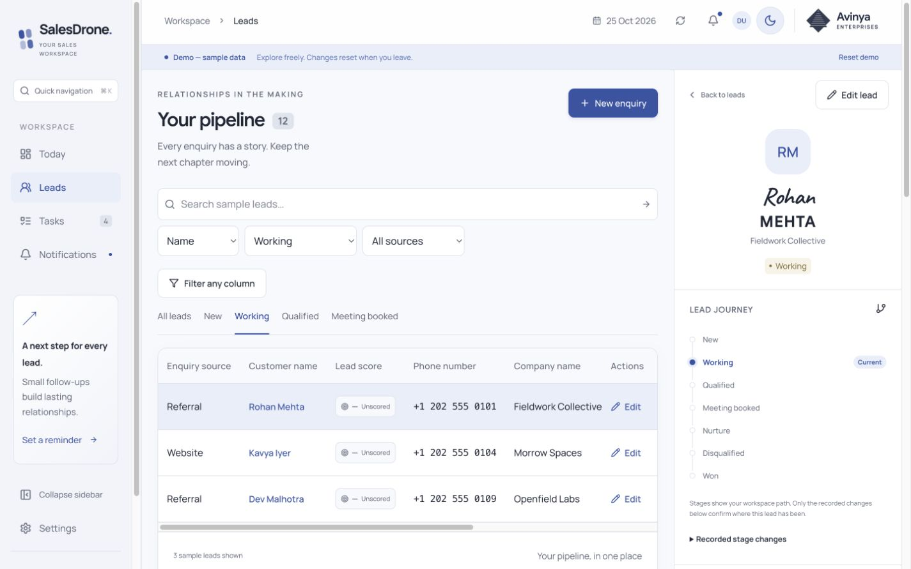
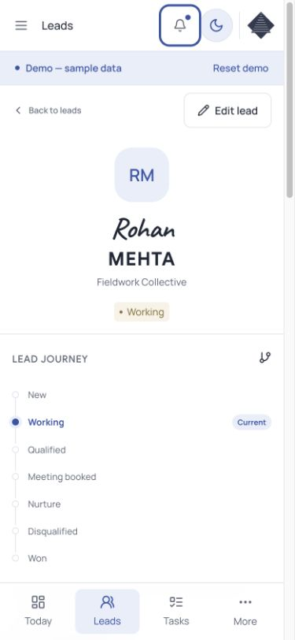

# SalesDrone by AvinyaTech

**Part of Avinya Enterprises · v1.0.0 · MIT**

A sales workspace that keeps an enquiry, its conversations and its next step together. Built with React, Firebase and Gemini, with a responsive interface for desktop and mobile.

[Open SalesDrone](https://sales-drone-avinya.firebaseapp.com) · [Illustrated guide](https://theharithsa.github.io/SalesDrone/) · [Releases](https://github.com/theharithsa/SalesDrone/releases) · [Deployment workflow](https://github.com/theharithsa/SalesDrone/actions/workflows/deploy.yml)


## From enquiry to follow-through

Import the first Excel worksheet or CSV, map the fields, and select several discussion columns to become separate dated comments. New enquiries then arrive through the form. Search and combine column filters, edit a lead, record a call, and keep its comments in one timeline.

A lead’s journey highlights its current stage and lists recorded stage changes. The dashboard funnel is a snapshot of current counts: selecting a stage opens its filtered leads. Its widths do not claim conversion rates or an invented history.



Gemini analyzes new call comments and lead notes for actionable follow-ups. Eligible reminders become tasks with visible dates and Edit/Undo; ambiguous instructions request clarification. Manual reminders, task editing, deletion, snoozing and completion remain available. Dashboard briefs and configurable evidence-based scores help prioritize outreach; scores do not independently verify credit, licensing or distance claims.

The notification bell opens an overlay without losing your place. Assignment and reminder notifications support read/unread state and browser push. Delivery still depends on browser permission, a registered device and platform support.


<details>
<summary>Mobile lead view</summary>



</details>

## Access and configuration

Google sign-in establishes identity; server-side membership and capabilities determine access. Unapproved users see an isolated synthetic demo, never live leads. Administrators manage people and permissions, field definitions, dropdown options, scoring factors and workspace preferences in Settings. Protected bootstrap administrators are defined in server configuration.

The repository contains application code and reviewed synthetic screenshots. It contains no imported customer workbook, production lead export, private credentials or production screenshots. Public Firebase browser configuration is an identifier, not an authorization boundary. Firestore client access is denied; the authenticated API enforces permissions and lead scope.

## Run locally

Use Node **22.18+**, npm, and Java **21** for the Firestore emulator.

```sh
npm ci
npm test
npm run check
npm run build
npm run dev
```

Select **Explore the demo** to preview without production credentials. For the local backend:

1. Copy `functions/.env.example` to `functions/.env.local`.
2. Run `npm run emulators` against **demo-salesdrone**.
3. Copy `apps/web/.env.example` to `apps/web/.env.local`, set `VITE_USE_EMULATORS=true`, and run `npm run dev`.
4. Use the Auth emulator’s simulated Google sign-in. Never point disposable test fixtures at production.

An unavailable live API produces an error; it does not silently replace a live workspace with demo data.

## Stack and technical documentation

| Layer | Technology |
|---|---|
| Interface | React, TypeScript, Vite, Radix UI, Recharts, CSS |
| Identity and access | Firebase Google Authentication, App Check, server-enforced capabilities |
| API and data | Node.js 22 Cloud Functions, versioned HTTP API, Firestore transactions and indexes |
| Follow-ups | Gemini, durable note analysis, scheduled reminder workers, Firebase Cloud Messaging |
| Monitoring | Dynatrace browser RUM, OpenTelemetry traces/logs/metrics, transactional BizEvent outbox |
| Delivery | GitHub Actions, Google Workload Identity Federation, Firebase Hosting/Functions, GitHub Pages |

- [Technical architecture and data flow](docs/TECHNICAL.md)
- [Versioned OpenAPI contract](docs/openapi.json)
- [Automatic reminders](docs/AUTOMATIC-REMINDERS.md) and [intelligence/scoring](docs/INTELLIGENCE.md)
- [Workbook mapping](docs/WORKBOOK-ALIGNMENT.md)
- [Observability contract and verification limits](docs/observability.md)
- [Release process, deployment and rollback](docs/RELEASE.md)
- [Security policy](SECURITY.md), [contributor/agent instructions](AGENTS.md), [third-party notices](THIRD-PARTY-NOTICES.md)

The automated checks cover domain policy, scoped access, imports, reminders, stage history and telemetry resilience, including independent decoding of actual OTLP protobuf. Firestore/Auth emulator integration exercises real queries and transactions. See the workflow for the exact checks and release evidence. An accepted monitoring request does not prove tenant searchability or native RUM-to-trace navigation.

## Releases

Main-branch pushes run verification, deploy Firestore indexes/rules, wait for indexes, deploy Cloud Functions and Hosting, check published commit metadata, and send the deployment result and version to Dynatrace. A separate job publishes only the curated documentation site. Cloud authentication uses short-lived OIDC credentials; ingestion credentials stay in Secret Manager and GitHub Actions secrets.

Start at **v1.0.0**. Subsequent changes use `npm run release -- patch`, `minor` or `major`, fill the dated [changelog](CHANGELOG.md), and commit the resulting version files. The workflow rejects version regressions or unchanged release versions on subsequent pushes. API contract versions are independent of app versions.

## Licence and illustrations

Application code is released under the [MIT licence](LICENSE), copyright Avinya Enterprises. Brand names and logos remain their owners’ marks. Font and dependency licences are documented in [third-party notices](THIRD-PARTY-NOTICES.md).

The public guide includes original generated illustrations made using the [Ian Xiaohei illustration workflow](https://github.com/tojileon/ian-xiaohei-illustrations-en). Their [review manifest](assets/salesdrone-guide-illustrations/QA.md) accompanies the source images. All app screenshots above come from the synthetic guest demo.
