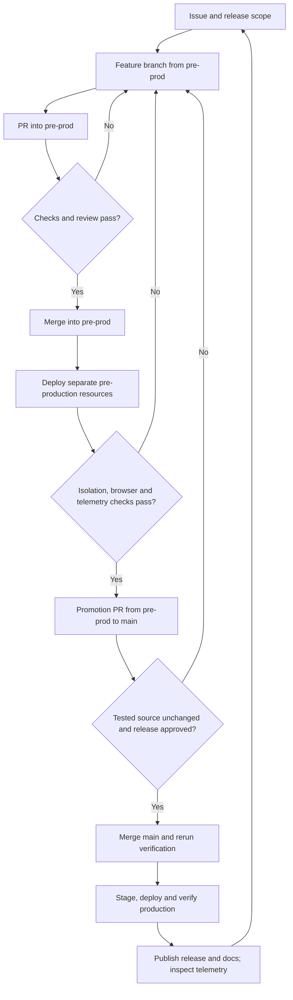

# Pre-production foundation

Status: **planned, not provisioned**. On 14 November 2026 the owner requested a
plan and GitHub implementation issues first. The v2.13.10 documentation release
does not create resources, change branch protection or enable a second deployment.

## Outcome and constraints

Develop and review changes against a `pre-prod` branch and a realistic dummy-data
workspace before opening a promotion PR to `main`. Production remains
`salesdrone.in`. Use the existing `sales-drone-avinya` Firebase project, a separate
named Firestore database, separate runtime resources and the existing Dynatrace
endpoint/token references. Tag every pre-production signal with the environment.
The owner's requested Google account becomes an Admin in pre-production only;
resolve its verified Firebase UID during the future seed operation, rather than
publishing account information in fixture files.

Firebase recommends separate projects for environment isolation. The owner has
requested a single project; this design therefore needs explicit data-plane and
deployment boundaries. Named databases do not isolate Firebase Auth, IAM, quotas,
Secret Manager, billing or project-wide configuration. Firebase Functions v2 uses
Cloud Run underneath. A second database does not receive another free Firestore
allowance. Do not represent this plan as a new free environment.

## Resource contract (proposed names)

| Concern | Production | Pre-production target |
| --- | --- | --- |
| Firebase project | `sales-drone-avinya` | Same project |
| Git branch | `main` | `pre-prod` |
| GitHub environment | `production` | `pre-production` |
| Hosting | Existing production site and domain | Separate `sales-drone-avinya-preprod` site, initially its `web.app` domain |
| Firestore | `(default)` | Named database `preprod`, same verified region |
| Functions | Existing `salesdrone` codebase | Separate `salesdrone-preprod` codebase and distinct function names |
| HTTP ingress | `salesdrone-ingress` | Distinct `salesdrone-preprod-ingress`; fixed upstream to the pre-production API |
| Attachments | Existing private production bucket | Separate private pre-production bucket; never a shared customer prefix |
| Runtime identity | Existing production identity | Dedicated least-privilege identity, database-conditioned Firestore grant and pre-production bucket access |
| Deployment identity | Existing production WIF/deployer | Separate pre-production WIF/deployer restricted to the repository, workflow and `pre-prod` ref |
| Authentication | Firebase Google sign-in | Shared project identity directory; pre-production database membership authorizes access |
| App Check | Existing production registration | Separate pre-production web app/key/domain configuration; keep enforcement |
| Cursor secret | Existing production secret | Distinct stable pre-production cursor-signing secret |
| Dynatrace | Existing secret and endpoint references | Same references; environment `pre-production`, distinct service instances and synthetic-data metadata |
| Analytics and notifications | Existing production behavior | GA4 off; push/email delivery suppressed by default; explicit controlled test recipients only |

Resource names must be verified for availability before provisioning. Domain setup
such as `preprod.salesdrone.in` is a separate optional DNS step; the initial Hosting
domain is sufficient for testing. Do not change production DNS for this work.

## Dependency order

1. **Isolation and configuration.** Define one validated environment manifest,
   inject the named database into every API and worker store, configure bucket,
   service identities, function names, ingress target and telemetry. Missing or
   contradictory pre-production values must fail startup. No fallback to default
   Firestore or the production bucket. Verify effective IAM, including inherited
   grants, rather than relying on a conditional grant alone.
2. **Synthetic workspace.** Create an idempotent seed procedure that refuses the
   default database, refuses production targets and requires the explicit
   pre-production marker. Add the designated verified owner UID as Admin in that
   database. Never create production membership as a side effect. Use fake leads,
   contacts, notes, tasks, stages and custom fields; never copy production records,
   device tokens, personal chats or import files.
3. **Delivery and promotion.** Deploy only to the separate resources from an
   approved PR merged into `pre-prod`. Add environment-specific smoke tests and
   evidence. Protect `main` with a promotion gate that checks the tested source
   tree/candidate and successful pre-production evidence, then reruns checks on the
   merged production commit. Do not enable this gate until a verified pre-production
   deployment exists, otherwise the normal repair path could be locked out.
4. **Telemetry and acceptance.** Verify logs, traces, metrics, committed events,
   CI/test/deployment events and RUM environment labeling. Rehearse denied
   cross-environment reads/writes, seed replay, failed deployment, promotion and
   recovery before declaring the new process active.

## Proposed branch and approval flow

A branch is a code history, not a database. Merging never copies pre-production
Firestore data into production. Promote the verified source and build provenance;
keep environment-bound configuration separate. Record pre-production source SHA,
source tree, workflow run, artifact digests, checks and approval. A new commit after
acceptance invalidates that acceptance and needs another pre-production run.
Production receives its own merge SHA and deployment evidence. Preserve the PR-first
workflow and never bypass failed checks with an administrative merge.

Do not publish production release tags, production release notes or advance the
public shipped version from a pre-production push. Add a conspicuous pre-production
banner to the app and include environment identity in version metadata and API
health evidence. Browser caches and service workers must remain origin-separated.

## Identity and side effects

Shared Firebase Auth means a user has the same Google/Firebase UID in both
workspaces. Authentication proves who they are; membership in the selected
database decides whether they may use that environment. Do not disable/delete the
shared Auth user, change production claims, weaken App Check or reuse a permissive
production bootstrap allowlist for test members. Production membership must remain
unchanged after pre-production provisioning and after its seed is replayed.

Test access includes the specified owner and only deliberately invited test users.
The pre-production runtime must be unable to read or write production Firestore or
attachments even if application configuration is incorrect. It must not have broad
project Editor or unconditional datastore access. Secrets are individual bindings;
sharing the Dynatrace token is explicitly requested, but that does not grant access
to all project secrets. Pre-production compute and ingress use zero minimum
instances and bounded maximum instances.

Scheduled workers must target the pre-production database and use separate job
names. Keep frequent workers paused outside test windows until a measured budget
supports continuous operation. Outbox drains, cleanup, reset, imports and AI jobs
must all be covered by environment isolation tests. Notification tests must not
reach production recipients. Never clone production data for convenience.

## Dynatrace contract

Keep the current tenant URL and server-side token references. Use
`deployment.environment.name=pre-production` consistently in OTel resource
attributes, logs, event payloads, CI/test records and deployment events. Keep the
production value `production`. Use environment-qualified service/resource names
where needed to avoid conflating ingress and worker instances. Include version,
commit and workflow-run evidence; use safe bounded synthetic-data flags, not raw
fixture text or email addresses. RUM must expose the environment as an approved
property and use the correct pre-production origin. No token enters the browser.

The implementation must audit hardcoded production defaults in Functions telemetry,
ingress telemetry, release notifiers, CI reporting and browser RUM. A label on one
signal does not establish complete isolation. Verify the same synthetic request
through ingress/API traces and safe logs, then verify worker/committed event
correlation and metrics. Keep ingestion acceptance distinct from tenant search and
native cross-signal linkage. No tenant dashboards or settings are changed by this
planning work.

## Cost envelope and seed budget

Start with 30 synthetic leads, up to 60 activity entries, 12 tasks, a small set of
workspace configuration documents, and the explicitly authorized Admin. Use stable
fixture IDs and an operation manifest. Plan an upper bound of 250 document writes
for the first seed, including derived records/outboxes; measure actual operations
and revise the budget before approval if the real domain path exceeds it. Seed
reruns compare the manifest and avoid duplicates or resetting manual test edits.
A destructive reset is a separate explicit operator action.

Idle target: no browser polling when no test user is active, zero minimum compute
instances, and paused optional schedules outside controlled test windows. Measure
cold/warm visits, first seed/replay, a sample import, AI use and a complete promotion.
Include billed index reads, scheduled invocations, Storage, build images and Gemini
usage; two databases in one project do not create independent free quotas. Record
actual before/after usage and budget alerts before continuous test traffic is enabled.

## Acceptance and activation gates

- [ ] Environment manifest rejects default database/production bucket/upstream in pre-production.
- [ ] Effective pre-production IAM cannot access production data or attachments.
- [ ] Hosting rewrite, Functions, ingress, cron jobs and worker stores point only to pre-production.
- [ ] Owner can sign in as pre-production Admin; unauthorized identities are denied; production membership is unchanged.
- [ ] Dummy data appears and replay does not duplicate or overwrite test edits.
- [ ] App Check remains enforced; notification/analytics side effects are contained.
- [ ] PR to pre-prod runs checks; pre-prod merge deploys only pre-production.
- [ ] Main promotion requires valid acceptance evidence for the tested source tree.
- [ ] Failure rehearsal leaves production unchanged; failed production rollout follows the existing recovery runbook.
- [ ] All required Dynatrace signals identify pre-production with no customer data.
- [ ] Measured operations meet the agreed budget; expensive idle work is disabled.
- [ ] SDLC guide changes its pre-production status from planned to active only after these gates pass.

## References

- [Firebase environment guidance](https://firebase.google.com/docs/projects/dev-workflows/overview-environments)
- [Hosting multisite boundaries](https://firebase.google.com/docs/hosting/multisites)
- [Named databases and database-specific IAM](https://firebase.google.com/docs/firestore/manage-databases)
- [Firestore quotas and one free database per project](https://firebase.google.com/docs/firestore/quotas)
- [GitHub deployment environments](https://docs.github.com/en/actions/concepts/workflows-and-actions/deployment-environments)
- [Existing release runbook](RELEASE.md)

## Tracked implementation

Milestone: [Pre-production foundation](https://github.com/theharithsa/SalesDrone/milestone/69). Parent: [#222](https://github.com/theharithsa/SalesDrone/issues/222). Native sub-issues and blocked-by relationships enforce the order: [#223 isolation](https://github.com/theharithsa/SalesDrone/issues/223) → [#224 synthetic seed](https://github.com/theharithsa/SalesDrone/issues/224) → [#225 delivery](https://github.com/theharithsa/SalesDrone/issues/225) → [#226 acceptance](https://github.com/theharithsa/SalesDrone/issues/226). All are assigned to the repository owner. Implementation dates and a versioned release milestone will be set when work is scheduled.

## Initial rollout

The separate Firebase site and named Firestore database were provisioned on
14 November 2026. The runtime identity can read its seed manifest and list its
private bucket. Equivalent read probes against the production database and bucket
returned permission denied. The owner and 30 synthetic leads and 12 tasks were
seeded in 116 writes. A replay issued zero writes.

The initial deployment exposes only the API and ingress. Scheduled jobs, push
delivery, browser RUM and GA4 have no active pre-production traffic. Paid AI
requests are disabled on the test API. Shared Firebase Hosting IAM is project
scoped. The pre-production workflow uses a separate deployment account and pins
the site, function, service and source bucket in its deployment scripts.

The production workflow compares the merged source tree with a successful
pre-production workflow run. Keep the epic open until authentication, telemetry,
cost and promotion acceptance have been exercised.
