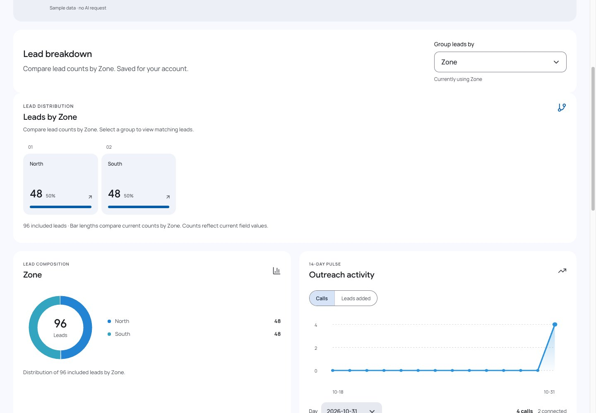
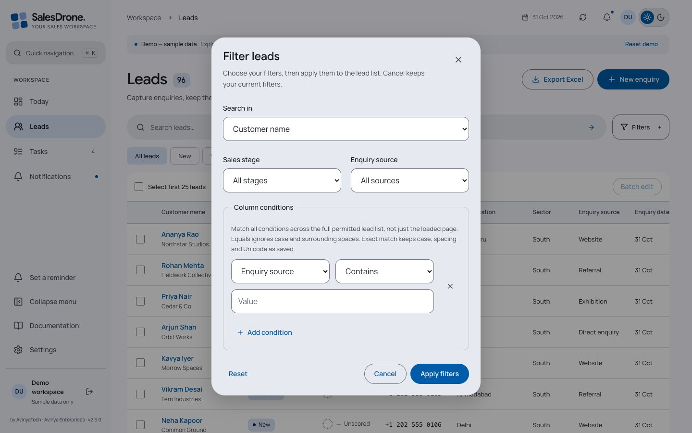
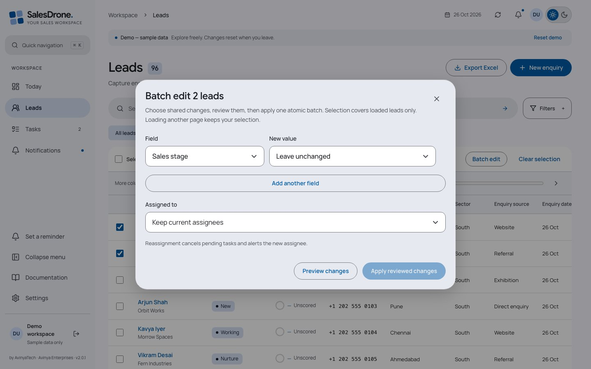
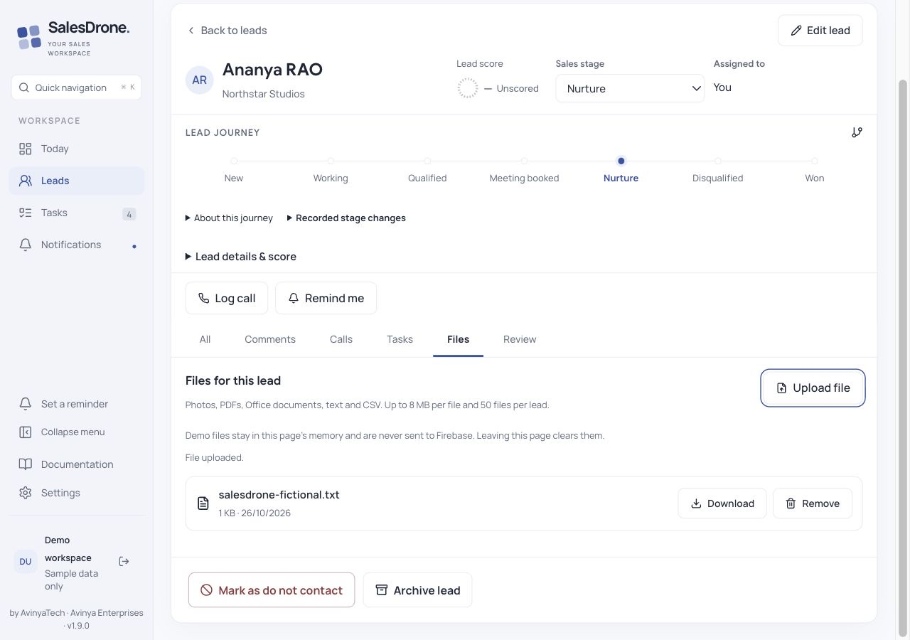
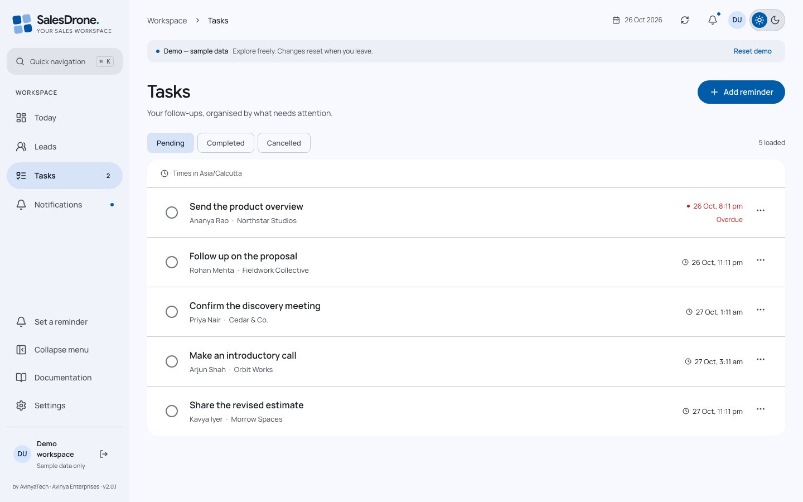
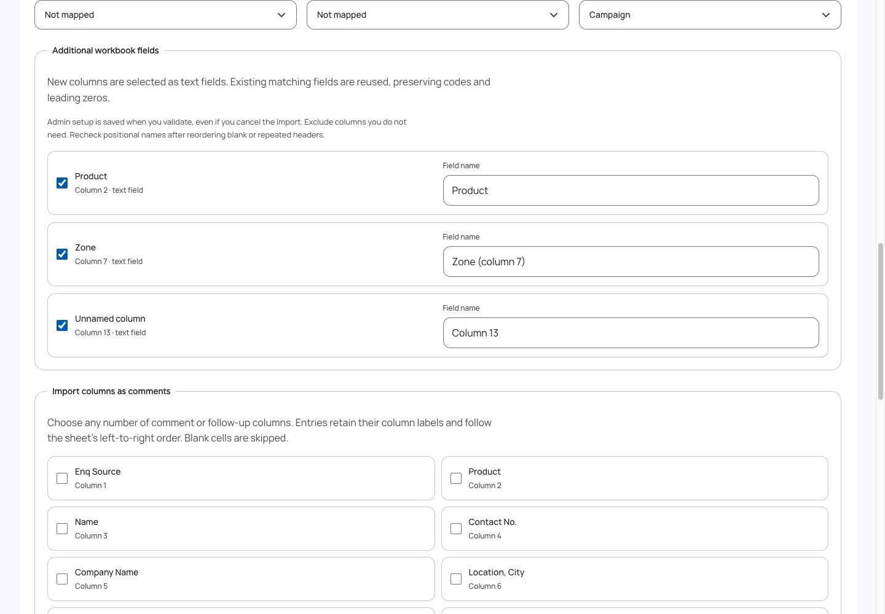
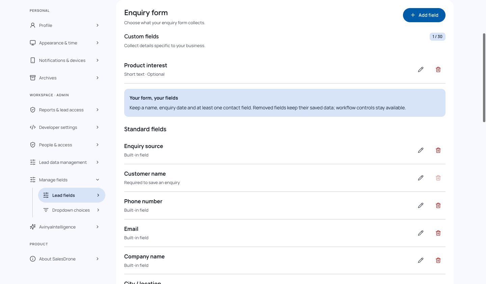
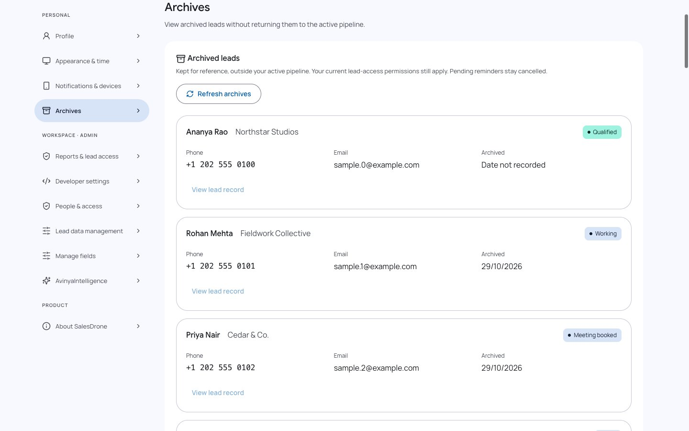
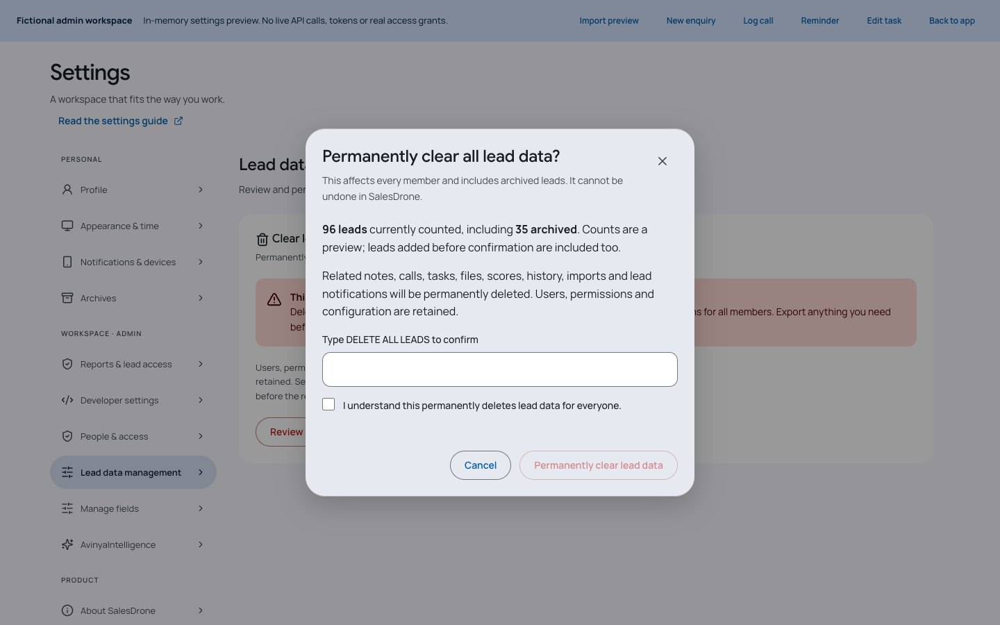

# SalesDrone product handbook

Version 2.5.2

[Complete settings reference](SETTINGS.md) · [API guide](API.md) · [Technical architecture](TECHNICAL.md)

## Getting started and signing in

Everyone

1. Open SalesDrone and choose Continue with Google. Use the account your administrator approved. Allow the sign-in window; if your browser blocks it, use the redirect sign-in option.

2. An approved active member enters the live workspace. An unapproved identity sees isolated demonstration records. Signing in alone does not grant access to company leads.

3. For a safe rehearsal, choose Explore the demo on the login screen. Changes are temporary and reset when you leave or choose Reset demo.

4. Check your profile and timezone in Settings before scheduling follow-ups. Enable notifications on each browser where you want alerts.

SalesDrone by AvinyaTech, part of Avinya Enterprises, helps small teams move from enquiry spreadsheets to a clear next step for each relationship. Start with imports, then capture new enquiries through the app form. No telephony integration is implied: you log the outcome of calls you make.

Navigation includes Today, Leads, Tasks, Notifications, Documentation and Settings. Members with import access also see Imports and history. The bell opens an inbox overlay; it does not replace your current working page. Documentation opens this handbook in another browser tab.

Use the bottom sidebar control to collapse or expand desktop navigation. Icons retain the same alignment and accessible labels. On narrow screens, use the menu or bottom navigation. The top-right appearance control switches theme; Settings also offers system appearance. Reduced-motion preferences reduce movement.

Set a reminder is a regular sidebar menu shortcut when you have task-writing permission. It opens the manual reminder form without a promotional banner; on phones it is available in the navigation menu.

### Questions

**Why do I see sample data after Google login?**

Your identity is authenticated, but workspace membership is missing or inactive. Ask an administrator to approve your account under Settings > People & permissions. Do not enter real customer information in demo mode.

**Does this application call leads automatically?**

No. Phone and email links open your device’s handler. Call logging, reminders and AI analysis help you record and plan outreach; they do not place calls.

## Today: charts, insights and lead breakdown

Members with access to the underlying leads

1. Open Today to review your accessible leads and outstanding work. Check due or overdue tasks before starting outreach.

2. Use Get insights to request a grounded outreach brief in manual mode. If automatic insights are enabled by an administrator, the button is hidden and the brief is requested when you visit the dashboard.

3. Read the selected-field distribution and other charts together with the task list. Use Leads filters to examine the records behind a pattern.

4. Use Chart day below the outreach chart to select a date. Its summary and highlighted point update from the already loaded data; this does not request AI insights.

5. Choose Group leads by for your lead distribution charts. Automatic uses Enquiry status when Sales stage is hidden. Your choice is personal and saved immediately; it does not change workflow stages or KPI definitions.

Charts describe current accessible records. The lead breakdown groups counts by your selected field; headings, descriptions and notes use its configured label, whether Zone, Enquiry source or a custom field. Recorded stage history remains in the lead journey.

AvinyaIntelligence uses reported workspace evidence. Insights are suggestions, not guaranteed sales outcomes. Missing information is not proof of disinterest. Administrator instructions shape the brief but do not bypass access controls. Manual mode avoids requesting a new summary on every dashboard visit.

Changing the lead list, completing tasks or refreshing may update aggregates. If a brief seems stale, request another in manual mode. AI availability depends on the server configuration and provider.

Available categories include configured built-ins and active custom text/dropdown fields. Missing values are a separate group. Select a concrete group to open matching Leads; up to 20 groups are shown and remaining values are combined as Other values. That aggregate and very long text groups have no direct filter. If a saved field is retired, a notice explains the fallback. Demo choices stay local.

### Questions

**Why is Get insights missing?**

Automatic mode may be enabled, or your identity does not have access to that feature. Check Settings > AvinyaIntelligence > Insights.

**Does this breakdown show historic conversion?**

Use it for current distribution only. Recorded stage history on a lead is the evidence of its actual transitions.

## Leads: capture, search, filters and editing

Members; actions depend on capability

1. Open Leads and select New enquiry. Complete the required name and contact information and any workspace-specific fields. Save once and wait for confirmation.

2. Enter text and run search. Open Filters to choose the search field, stage or source; choose Filter any column for company, city, sector, name, dates or supported custom fields.

3. Click a customer name for quick inspection. On desktop it opens above the unchanged table. At widths up to 1000 CSS pixels it opens the dedicated lead page directly, without an offset sheet. Use Back to leads; desktop overlays also close with Escape.

4. Drag the overlay’s left edge to change its width. Arrow Left/Right resize the focused separator; Shift doubles the step, Home/End select the limits, and double-click resets it. Width is remembered in this browser.

5. Open a lead, then choose Edit lead inside its details or full page to update an existing enquiry. Save against the current version; reload if another change caused a conflict.

The source worksheet naming is made readable in the application: Enquiry source, Customer name, Phone number, Company name, City / location, Sector, Enquiry date and Enquiry status. Sales stage is separate from original imported status. Serial number is not a required application field.

Administrators can customize labels and supported field options under Manage fields. Labels change presentation; stable internal field IDs keep imports and API integrations consistent. Retired fields preserve existing data rather than erasing history.

Non-admin lead visibility follows workspace Reports & lead access policy and membership scope. Administrators can require assigned-only access. Filtering and exporting do not grant access to additional records.

Do not contact pauses eligible outreach; a review flag means the contact should be checked before outreach. Archive removes a lead from ordinary active work and cancels pending outreach; it is not permanent deletion.

Search stays visible. On mobile, Filters opens a dialog for search field, stage, source and column conditions. Apply filters commits the draft and closes the dialog; Cancel or Escape keeps the existing filters. Reset clears the draft until applied. Desktop retains the inline disclosure. Stage shortcuts scroll within their row.

Customer names in the table align to the same column edge, including names that wrap. The table scrolls locally when columns need more room; reducing the whole application zoom is not required for alignment.

The list has no row-level Edit controls or Actions column. Open the customer name (or the mobile lead card), then choose Edit lead. When the customer-name column is hidden by configuration, the desktop row remains keyboard-focusable: press Enter or Space to open its details.

Infinite scrolling loads the next page automatically as you approach the bottom of the lead list. The initial live page requests up to 30 leads; sparse filtered scans may contain fewer results with another cursor. Loading continues until the API returns no cursor. Load more leads remains available as a keyboard/browser fallback; failures pause automatic loading and show Retry loading leads. Changing filters starts a fresh list. Demo mode uses 96 fictional leads, revealed 30 at a time.

On mobile, New is the primary header action. Export Excel and permitted Import actions are under the three-dot More lead actions button. Search and the filter icon share a row. All stages provides a compact quick stage picker; desktop retains its action buttons and stage shortcuts. Small screens shorten action labels, and large mobile counts use compact notation.

Choose Exact match for Enquiry source, Sales stage or an available custom dropdown to match the saved value exactly, including case, spacing and Unicode. Equals continues to ignore case and surrounding spaces. All conditions narrow the accessible list together; filters never expand assignment access.

### Questions

**Why does a filter show no results?**

Clear other filters, check spelling and the selected search field, then confirm the record is within your current assignment scope. Multiple filters narrow the result together.

**Why did my edit fail?**

A newer version may exist, or your access changed. Refresh and reapply the intended change. Do not repeatedly resubmit an outdated version.

**Why does Equals find a row that Exact match does not?**

Equals normalizes text. Exact match requires the same saved case, spaces and Unicode representation. Check the saved value or use Equals when tolerant matching is intended.

## Batch edit existing leads

Members with lead-edit access; assignment permission for reassignment

1. Filter Leads to the records you need, then tick individual selection boxes or Select loaded leads. A batch contains at most 25 explicitly selected loaded records; this does not select every record matching server filters.

2. Choose Batch edit. Pick shared fields and values; Add another field for additional changes. Leave unchanged retains each lead value. Clear value removes an optional value; required-field validation still applies.

3. Choose an assignee only when permitted. Reassignment cancels pending tasks and alerts the new owner. Names, phone/email and discussion history are edited individually inside a lead.

4. Select Preview changes and inspect the before/after rows. Apply reviewed changes commits all selected updates together. A stale, archived or inaccessible lead rejects the whole batch; refresh and preview again.

Loading another page keeps your existing selection; new rows are not automatically selected. Changed or removed records leave the selection, and changing the lead filters resets it. At most 25 leads are written per atomic transaction. No-op rows retain their versions.

After a connection failure, the outcome can be uncertain. Retry the same reviewed action safely or refresh to inspect the result; the API reuses the same idempotency key. Never assume the batch failed solely because a response was lost.

### Questions

**Can I batch replace phone numbers or old comments?**

No. Shared contact values would create duplicate identities, and conversations need their own timelines. Open the individual lead to edit contact details or add/correct a conversation.

**Why did nothing update?**

One selected record may have changed, been archived or moved out of your scope, or a value may not match current field definitions. The API applies no partial batch. Refresh and preview using current versions.

## Full lead page: All, Comments, Calls, Tasks and Review

Members who can read the lead

1. On desktop, select Open full lead page in the inspection overlay. On phones and narrow tablets, opening a lead goes directly to this page. The URL is /leads/{leadId}; bookmarks still require current authorization.

2. Use the stage and assignment controls at the top. Assignment editing is an administrator action. Read-only users see status rather than gaining access to the people directory.

3. Read the horizontal journey. Expand Recorded stage changes for actual recorded transitions. Open Lead details & score when you need the full enquiry context.

4. All opens first and includes every loaded activity and review information. Your private linked tasks appear only in Tasks. Choose Comments for notes and imported discussion comments, Calls for call entries only, Tasks for your linked work, or Review for issues needing attention. All and Comments include the inline Write a comment field. Arrow keys move between tabs; Home/End select the first/last tab.

5. Use Back to leads to return to the list. Filters remain available during the current session; a shared link still requires sign-in and current permission.

Comments includes only note entries, including imported discussion columns. Calls includes only logged calls and their outcomes. All includes both plus other activity and the existing review cards, without duplicating entries. Entries preserve timestamps, original import columns where known, line breaks and correction controls. Earlier activity loads another page instead of rendering every entry at once.

Tasks is recipient-private. Its status filter includes Pending, Completed and Cancelled, with All statuses as the starting view. Select a card to view, edit, complete, reschedule or delete using the existing task dialog. Refresh tasks after a change; Load more tasks retrieves another page. Administrators do not automatically gain access to another person’s private tasks.

Review shows contact review/suppression information and automatic follow-ups with Pending, Failed or NeedsReview state in the loaded activity. It is not an approval queue for every company operation. Load earlier activity to inspect older entries; an empty loaded page does not prove all historical work is reviewed. Use the existing reminder card to set a date, retry or dismiss when allowed.

The full-page identity header reads first and last names horizontally. Long names wrap naturally, with company below and the stage badge moving below the name in narrow containers.

Lead actions at the bottom use full-size buttons. Mark as do not contact pauses eligible outreach; Archive lead archives the record. Neither label means permanent deletion. Buttons wrap on narrow screens, retain keyboard focus and follow the existing permission/loading checks.

Mobile typography uses a 28px page-title role, 22px lead identity, 17px body/form text and 15px supporting text at default browser settings. Existing font families are retained. Stage/assignment controls reflow to available width and the journey scrolls horizontally, without widening the document. Browser text preferences and zoom may change the visual sizes.

Log call and Remind me appear once above the tabs. Expanding Lead details & score shows a single labelled Lead information list, including email. Available phone/email links follow contact review and do-not-contact guards. The quick-inspection overlay has its own compact actions; those are not repeated on the full page.

The lead header groups the person, a small score ring, current sales stage and assignee. It reflows by available content width. The journey is a compact horizontally scrollable path; About this journey and Recorded stage changes expand separately. The ring shows a known score out of 100; a dashed ring means Unscored, which is different from a known zero. Reported risks retain an explicit warning label; a score is not a verified commercial guarantee.

Files is a separate tab for private lead attachments. It is not part of All activity; comments/calls and tasks keep their existing tabs. Existing Ready files stay with a lead when it is reassigned, while pending uploads are invalidated by assignment changes.

On phones, use the checkbox on the left of a lead to select it for batch editing. Selecting does not open the record; use the adjacent name/card to open it.

### Questions

**Can another person open my bookmarked lead page?**

Only if their current workspace membership and scope allow reading that lead. URLs do not act as access tokens.

**Why are there fewer tasks than I expected?**

The tab shows your tasks linked to this lead, subject to current access. It does not show another recipient’s private reminders. Check the status filter and Load more tasks.

## Lead files and attachments

Lead readers; editors for upload and removal

1. Open a lead in its full page and select Files, or use Files in the desktop quick inspector. Choose Upload file, then select a supported photo or document. Files are private to people who currently have access to this lead.

2. Wait for upload progress and File uploaded. A failed upload offers Retry upload or Discard pending upload; Cancel upload stops the transfer. Keep the tab open until completion.

3. Choose Download to save a file to your device. There is no permanent public sharing link. Refresh files retrieves current metadata; Load more files follows the next page.

4. Choose Remove, then Confirm removal. The file becomes unavailable in SalesDrone immediately. Removal has no in-app restore button; underlying Storage cleanup happens later.

Limits: 8 MiB per file and 50 active/pending files per lead. Supported: JPEG, PNG, GIF, WebP, PDF, DOC/DOCX, XLS/XLSX, PPT/PPTX, UTF-8 text and CSV. Executables, HTML and SVG are excluded. File extension, declared type, size and signature are checked. Files are stored, not malware-scanned or sent to AI.

Pending reservations expire after one hour. Cleanup grants an additional hour before deleting expired pending bytes, protecting against late uploads. Explicit removal hides access immediately and waits an hour for physical deletion. Failed cleanup retries.

Existing completed files follow the lead after reassignment. New/current authorized owners may download them; former assigned-only owners lose access. Only the reserving user can finish a pending upload, and assignment changes invalidate it.

Demo uploads stay in page memory and never go to Firebase. Leaving the Files tab clears demo files; demo upload success proves the interface only.

### Questions

**Why did an upload stop after reassignment?**

The API rechecks current membership, assignment and permissions after storing private bytes and before publishing the file. Start a new upload with current access; abandoned bytes are cleaned up.

**Can I share a file URL with another person?**

Downloads require current Google/App Check authorization or an explicitly scoped active Personal Access Token. SalesDrone does not issue a durable public URL.

**Why is Upload file unavailable?**

Your role may be read-only, or a transfer/pending retry is active. Readers can download permitted completed files; editors can upload/remove them.

## Call logs, comments and corrections

Members with activities:write for changes

1. Open a lead and choose Log call. Select the actual outcome, add discussion notes and any supported disposition or follow-up fields, then save.

2. On the full lead page, type directly into Write a comment in All or Comments and choose Post comment. In the quick-inspection overlay, Add comment still opens the compact dialog. Each successful post creates a separate entry.

3. Check notes in Comments and logged calls in Calls; All combines both. If you made a mistake, choose Correct entry and submit a correction; the original revision remains part of the record.

4. Use Earlier activity to retrieve older pages. Imported discussions show their source column; an unknown original conversation date is explicitly described as unknown.

Call outcomes and lead sales stage are different concepts. No answer records an attempt; Qualified describes the relationship’s sales stage. Change the stage only when the underlying relationship warrants it.

Corrections preserve previous revisions and invalidate stale analysis so an old interpretation cannot silently schedule new work. Imported historical discussions do not automatically create fresh callbacks.

Notes can contain customer context; keep them out of support screenshots and public documentation. Application telemetry excludes comment content and task titles.

Inline drafts stay in memory while you switch All, Comments, Calls, Tasks and Review for the same lead. Failed posts retain text; retrying an unchanged uncertain write reuses its original identity. Blank and in-flight posts are disabled. Drafts are cleared when you leave that lead, change account or reload; customer notes are not stored in browser storage.

Activity cards use a compact reading hierarchy: 15px entry titles and desktop comment text, 16px comment text on narrow/touch layouts, and 13px timestamps. Padding and spacing are reduced without clipping notes or hiding earlier activity. Newlines and full text are preserved. The same sizes apply in Book mode and every chosen interface font.

### Questions

**Can I delete the old wording by correcting a comment?**

Corrections keep revision history. They are not a permanent erasure mechanism.

**Does importing a discussion mean the call happened on import day?**

No. Import time is not the original discussion time. Unknown historical dates remain unknown.

## Automatic reminders from notes

Members with eligible notes and task permission

1. Check Settings > your follow-up preferences, including automatic reminders, timezone, default time and next-week interpretation.

2. Add a new call comment or note that contains a clear future action and date. Save it and look for Checking for a follow-up in the timeline.

3. After the background worker runs, inspect the outcome. A scheduled card shows the interpreted date and timezone. Confirm the intended time before relying on it.

4. Use Edit or Undo on a scheduled result, Set date manually when timing is unclear, Retry after an analysis failure, or Dismiss to stop that suggestion.

Gemini extracts a proposed follow-up in the background. A scheduled task uses the same ownership, delivery, suppression and version rules as a manual task. Ambiguous instructions can require review instead of creating a task.

The worker runs approximately once per minute; provider latency and retries add time. Imported historical notes are excluded from silently generating fresh work. Manual follow-ups specified with the originating action should not be duplicated.

Notes are untrusted content, not instructions to change application policy. Automatic reminders never override do-not-contact, inactive membership, current ownership, task completion/deletion or scope restrictions.

### Questions

**I wrote “follow up soon”; why is there no task?**

The timing may be ambiguous. Open Review and use Set date manually, or add a clear future date/time. Also check that automatic reminders are enabled.

**A reminder was scheduled at the wrong time. What now?**

Use Edit on the card or edit the task. Check your timezone and default-time preferences. Undo dismisses the automatic result when allowed.

## Tasks, reminders and completion

Task recipients

1. Open Tasks to review your work. Choose New on phones or Add reminder on desktop, or use Remind me on a lead for a linked follow-up. Set the title, date/time and task kind.

2. Select a task title to see its details. Open its Actions menu for Edit task or Delete task; pending tasks also offer Snooze 1 hour, Reschedule and Cancel task. Use the circle beside a pending task to complete work after it is actually done.

3. Delete only when the task is no longer needed. The application uses soft deletion and prevents old scheduled jobs from reviving the task.

4. Choose Pending, Completed or Cancelled using the phone status picker or desktop status buttons. The loaded count describes the rows currently loaded, and the list header shows the display timezone. On the full lead page the Tasks tab narrows the same private task service to that lead.

Times are stored as instants with IANA timezone context. Invalid or ambiguous local times, including daylight-saving edge cases, may need correction. The form tells you which timezone it uses.

Each edit changes the task version and invalidates old delivery work. A due task may create an inbox notification and send to eligible registered devices. A task being due does not guarantee an operating-system banner appears immediately.

Lead-linked outreach can be cancelled or suppressed by reassignment, review, do-not-contact, archiving or lost access. A private reminder is not a shared team assignment.

### Questions

**Why did a task disappear after reassignment?**

Reassignment cancels pending lead outreach to prevent contacting the lead under an outdated owner. The new owner should set the next reminder.

**Can an administrator edit my reminders?**

Task recipient privacy remains in force. Administrator status alone does not grant editing rights to another person’s private tasks.

## Inbox and push notifications

Each signed-in member on each device

1. Click the bell to open the notification overlay without leaving your current work. Open an entry to follow its lead/task link when still accessible.

2. Use the read/unread controls to organize the inbox. An unread badge indicates unread entries; reading does not complete the linked task.

3. In Settings > Notifications choose Enable notifications and allow the browser prompt. Use Send test to check device registration.

4. Test a near-future reminder with another tab active. Repeat device setup in each browser/profile where alerts are needed.

Lead creation/assignment alerts are routed to the eligible assigned person. Reminder delivery is private to the recipient. Browser push permission, device registration, membership and current domain access all matter.

Push previews are intentionally generic and do not include lead notes or private customer details. A notification link checks current access again; a stale notification cannot grant access to a reassigned lead.

Operating-system focus modes, browser background restrictions and denied site permissions may prevent banners even when the inbox has an entry. Inbox read state and OS banner visibility are different things.

### Questions

**The app says notifications are ready but I saw no banner.**

Check browser site permissions, operating-system notification settings and focus mode. Run Send test, then inspect the inbox separately.

**Does marking unread resend push?**

No. Read/unread organizes the inbox; it does not recreate reminder delivery.

## Excel and CSV import

Members with optional import permissions and import-capable administrators

1. Open Imports & history. Find previous jobs by status or date; Load older imports follows server pagination. Your permissions determine which jobs and rows you can inspect.

2. Choose a new workbook, or choose Update this workbook on a completed import to link a revised upload to its source comparison history. Upload XLSX/CSV, map columns and choose the duplicate/update mode.

3. Review Additional workbook fields. Every populated unmatched column is selected as a reusable text field by default. Rename if needed or explicitly exclude a column. Admins choose Create / reuse fields & validate; other importers must ask an Admin for setup or map/exclude those columns.

4. In Map existing statuses, Enquiry status is the default destination. Map statuses to lists all compatible active category and custom text/dropdown fields, including fields already mapped to workbook columns. Hidden or retired fields are excluded. Keep original text only applies no extra mapping.

5. Validate records to prepare a row-by-row comparison. Inspect existing matches, current versus workbook values, worksheet row numbers and proposed actions. Exact name and phone matches are candidates; ambiguous matches require a decision.

6. Choose Approve clear proposals for unambiguous changes. Compare selected lead resolves a match first; then review its fields. Conflict fields start unchecked, keeping the database value unless you explicitly choose the workbook value.

7. Skip rows you do not want to process, or explicitly clear mapped optional values. Apply reviewed changes starts bounded, versioned commits. A blocked job requires Refresh remaining matches and another review.

8. Use View import to reopen progress from any browser. Authorized collaborators can resume; current lead scope still applies. Admins can delete retained import details without deleting already saved leads.

The current default is skip duplicates. Review updates to existing leads is a separate mode; Keep separate enquiry rows explicitly allows distinct enquiries with repeating contacts. Stable SalesDrone lead ID mapping helps when identifiers change. A filename or worksheet row position never identifies a person.

A linked source comparison checks the prior imported value, current database value and incoming value. Unchanged workbook cells preserve team edits. Different edits in both places are conflicts. Older imports without a source baseline require an initial explicit comparison.

Blank or unmapped cells leave existing values unchanged. Optional clearing is explicit. Assignment, archive, do-not-contact, review flags and workflow state are not reset by missing columns. Rows omitted from a later workbook are not deleted.

Each nonblank selected discussion cell remains a distinct historical note. Accepted corrections retain prior revisions; re-importing unchanged cells does not repeat them. Renamed/ambiguous comment columns and reminder-linked discussion corrections need explicit review; imported history does not schedule new outreach.

Parsed rows, results and source values are retained until an Admin deletes details. Original workbook files are not stored. Deletion also clears the dataset’s source comparison baselines, so later uploads may need a new manual comparison; saved leads, discussions and summary audit history remain.

View history requires imports:read. imports:write allows planning/review/execution; imports:share adds shared jobs. Lead create/edit capabilities and assigned/all policy still apply. Non-admin import permissions are opt-in in People & permissions.

Download results produces a local JSON report with permitted row details, provided workspace exports are enabled. History is not a substitute for authorization; changing roles or assignments can redact results or block the next chunk.

Preview validity is one day before the first commit; Refresh remaining matches renews a preview. Active partial imports remain resumable. Per-route import write limits are 180 requests per minute; a rate-limit error retains progress for a later resume. Maximum 5,000 rows, 10 MB upload, 40 source columns and a 6 MiB parsed-payload budget apply.

Text fields preserve leading zeros and codes. Repeat uploads reuse existing field IDs. Selected comment columns remain historical notes; uncheck one to import it as a field instead. Empty columns are skipped and duplicate/blank headers have positional names. Field setup is a workspace change before preview, so those fields remain even if the import is cancelled. Limits remain 40 workbook columns and 30 active custom fields; limit/conflict failures stop setup without dropping columns. When Sales stage is hidden, Enquiry status is retained without a stage mapping.

Recheck positional field names when duplicate or unnamed headers move in a revised workbook. Positional defaults cannot establish which old column a moved blank header represents.

If a destination already uses a workbook column, Review existing column focuses its mapping. Remap that column elsewhere or choose Not mapped. Otherwise unused populated data appears in Additional workbook fields: retain it under a reviewed field name or explicitly exclude it. An additional field cannot reuse the status destination. Original workbook statuses remain in authorized import history; server overwrite guards and prepared jobs keep their existing contracts.

### Questions

**Will the revised workbook overwrite a teammate’s edits?**

Unchanged source cells preserve team edits. Conflicting field changes require your choice, and a record changed after review blocks the chunk until you refresh and review again.

**Why can I see a job but not some row details?**

Shared-import access and lead access are separate. Rows outside your effective scope are redacted. An Admin must grant the appropriate scope or assignment before you can inspect or update them.

**Can I update an old import?**

Select its completed job from history. If its source comparison values were never recorded or have been deleted, the first comparison needs explicit review. If both name and phone changed, map a stable lead ID or manually select the intended accessible lead.

**Can I stop and return later?**

Yes. The server retains the job and reviewed rows. Reopen it from history and resume. Version checks prevent two collaborators from applying the same stale chunk. Already committed rows are retained if later work blocks.

**Why is validation disabled after I choose a status destination?**

Resolve the displayed column conflict first. A separate column and status values cannot fill the same field. Use the review button to reach the existing mapping or additional-field name. Other importers can map existing fields or explicitly exclude columns; only Admins create new fields.

## Filtered Excel reports

Members, when exports are enabled

1. Apply the desired search and column filters on Leads. Verify the visible matches before opening Export Excel.

2. Choose the supported columns for the report, start export and wait for the paginated data retrieval and workbook generation.

3. Cancel if you selected the wrong filter or columns. Download the completed workbook and handle it as private company data.

4. Administrators can enable or disable this feature under Settings > Reports & lead access.

An export follows the active filters and current authorization; it is not an unrestricted database download. The server rechecks current access while report pages are read. Policy/account changes cancel pending work.

Workbook generation runs in a browser worker. Large result sets are bounded by the reports API; completion time depends on result size and the device. The export does not reveal private task data or another member’s inbox.

Exporting a sheet does not create a live two-way Excel connection. Later edits in the workbook do not update SalesDrone unless entered or imported through an authorized workflow.

### Questions

**Why is Export Excel unavailable?**

Exports may be disabled by the administrator, your identity may lack permission, or the workspace may still be loading.

**Will filtering by a city export every lead in that city?**

Only matching leads you are currently allowed to read, within supported report limits.

## AvinyaIntelligence and lead scoring

Members; configuration requires administrator

1. Open a lead’s Lead details & score section and read its score, evidence coverage and factor breakdown together.

2. Use refresh scoring when permitted and needed. Add factual business context through comments; do not invent evidence to raise a score.

3. Administrators configure Fit, Intent and Red-flag factors, weights and activation under Settings > AvinyaIntelligence > Lead scoring.

4. Customize insight instructions and manual/automatic mode under the Insights child section. Leave instructions blank to use the application default.

Fit factors include business/account profile, project capacity, geography, commercial credit and licensing. Intent can include bids, RFQs, samples, credit applications and inbound urgency. Red flags include uneconomic delivery distance, reported payment risk, unsuitable small volume and disputes.

Evidence extraction uses reported information, while score calculation is deterministic from configured factors. Unknown facts are not automatically negative. Scores help prioritize sales work and do not independently verify credit, licensing, distance or safety claims.

Configuration changes can cause background refresh work. A model response is not a source of truth about a prospect’s creditworthiness or commercial eligibility. Review evidence and use professional judgement.

### Questions

**Is a high score proof the lead will buy?**

No. It is a prioritization signal based on reported evidence and configured factors.

**Can we adapt factors to another business?**

Administrators can adjust the supported factors and weights. Document what each factor means so the team interprets scores consistently.

## Settings: complete control reference

Personal controls for members; workspace controls for administrators

1. Open Settings. On desktop use the left section navigation; on mobile choose a section from the dropdown.

2. Expand Manage fields to choose Lead fields or Dropdown choices. Expand AvinyaIntelligence to choose Insights or Lead scoring.

3. Change personal preferences only for your account. Review the scope of a workspace setting before saving, because it can change other members’ workflow.

4. Open the complete Settings reference from this handbook for each control’s default, scope, permission, API, effect, example and limitation.

Profile and appearance cover identity display, theme and timezone. Follow-up preferences control automatic reminder behavior, default time, next-week interpretation and weekend movement. Notifications manages browser device registration and tests.

Manage fields includes editable built-in labels, delete/restore icons for standard-field visibility, adding custom fields with stable IDs and types, and editing/retiring existing definitions. Name, enquiry date and at least one contact field remain available. Dropdown choices manages allowed values for supported field types. Retirement preserves stored values; incompatible type changes are constrained.

Reports & lead access controls exports and assigned-only visibility for non-admins. People & permissions manages members, invitations, role/capability and assignment scope. Developer settings manages scoped Personal Access Tokens. About describes the product and version.

The linked Settings reference is the authoritative per-control checklist. This chapter explains navigation; it does not replace that detailed reference.

The top-right theme switch shows sun and moon icons with a solid indicator on the active mode. It remains keyboard-accessible and removes animation when your device requests reduced motion. Book mode is available from v1.6.3 in Appearance & time; save the personal preference to apply it.

On phones, lead details stack Sales stage and Assigned to controls with matching labels and widths. Dashboard outreach labels align with their horizontal gridlines; use the metric switch and Day selector to inspect values.

### Questions

**Can I rename a built-in field?**

Use Manage fields > Lead fields. A label change does not rename its stable API key, so integrations keep using the documented schema.

**Can I remove a field without losing historical data?**

Use the delete icon in Manage fields > Lead fields. Standard fields can be restored with the restore icon; saved values remain intact. Customer name, Enquiry date and at least one of Phone number or Email remain available so new enquiries can still be saved. Removing a form field does not disable contact restrictions or workflow actions.

## Book mode: a quieter reading workspace

Every active member; personal preference

1. Open Settings > Appearance & time. On mobile, choose that section from the section selector.

2. Enable Book mode and select Save changes. The workspace uses warm paper surfaces, ink-like text and serif fonts throughout the UI, with monospace phone numbers.

3. Choose Light, Dark or System as usual. The top-right light/dark control changes day/night while preserving Book mode.

4. Return to Appearance & time, disable Book mode and save to restore the standard workspace.

The mode applies across dashboard, leads, tasks, forms, notifications and settings. All UI text uses a local serif font, including headings, navigation, tables, forms, buttons and chart labels; phone numbers remain monospace. Status distinctions remain readable. Page borders are restrained and no page-turn animation covers working data.

The saved preference belongs to your account, not the team. Existing clients that omit bookMode preserve the stored value. Demo/guest changes use a guarded local fallback; a live account uses its own server preference, default off.

This is a visual reading style. It does not add offline access, physical e-ink behaviour or a separate read-only view. You can continue editing and following up on leads. Reduced motion disables the theme indicator transition.

Book mode uses the same responsive type-size roles as the standard interface. Its serif family is preserved; the mode does not enlarge every passage indiscriminately.

### Questions

**Does switching to dark mode turn Book mode off?**

No. They are independent; dark Book mode uses charcoal paper and warm ink.

**Will this change my colleagues’ screens?**

No. Book mode is a personal preference.

**Why did the style not change after selecting it?**

Save preferences to apply it. If saving fails, the previous saved style remains in use; check the error and retry.

## People, permissions and assignment

Administrators

1. Open Settings > People & permissions. Invite or approve the intended Google account; verify its email carefully.

2. Set the role, capabilities and supported lead scope appropriate to the person’s work. Review active status and current ownership before granting access.

3. Assign a lead using the top-of-lead assignment control. The recipient receives an eligible assignment notification; pending old-owner outreach is cancelled.

4. Deactivate or adjust membership when responsibility changes. Recheck access with the affected user rather than assuming a cached page reflects current permission.

The two bootstrap administrator identities remain protected. Routine sign-in does not approve membership. Server policy is authoritative for every read, write, inference input and export; hiding a button alone is not an access boundary.

Role labels and capabilities are related but not interchangeable. A task remains private to its recipient. Assigned-only policy can further restrict non-admin lead access even when other capabilities are present.

Only grant access needed for the person’s responsibility. Do not share Google sessions or personal API tokens across employees.

### Questions

**Why can a member view but not edit a lead?**

Read access and editing capability are separate. Check both membership scope and the specific write permission.

**Does assigning a lead transfer existing private reminders?**

No. Old pending outreach is cancelled and the new owner sets the next appropriate reminder.

## Developer settings and API integration

Administrators creating scoped tokens

1. Open Settings > Developer settings > Personal Access Tokens. Choose a descriptive name, expiration and only the needed scopes.

2. Generate the token and copy the secret once into a secure server-side secret store. The application cannot show the original secret again.

3. Open the Swagger portal at the hosted /api/docs URL. Read the versioned request/response schemas and authorization requirements before sending a request.

4. Use Authorization: Bearer <token> from your integration. Follow cursor pagination, validation errors and expected-version requirements. Revoke unused or exposed tokens immediately.

The API supports documented reads and writes for leads, activities, tasks and other permitted resources. It does not offer arbitrary Firestore access. Archive and soft delete have explicit semantics; they are not equivalent to permanent erasure.

Token routes enforce supported scopes and the owner’s current active administrator membership. Expired or revoked tokens stop working. Compound operations can need more than one scope. Check the Swagger contract rather than inferring an endpoint from the UI.

Never put a token in a public repository, browser URL, client-side JavaScript, screenshot or support ticket. Browser sign-in/App Check and Personal Access Tokens are separate authentication paths.

### Questions

**Why does my token get 403?**

Check its scopes, expiration, revocation and the token owner’s current administrator membership. A valid secret does not bypass domain policy.

**Can an integration permanently delete leads?**

The documented lead removal workflow is archive. Use the published contract; do not assume a DELETE endpoint exists for every resource.

## Background services, privacy and operational limits

Administrators and integration maintainers

1. For a delayed automatic follow-up, check its timeline state first. For a missing banner, check the inbox and device test separately.

2. For an edit conflict, reload the latest record before trying again. For a forbidden operation, check current membership and scope.

3. When reporting an issue, include app version, action, approximate time/timezone and exact non-sensitive error text. Redact customer names, emails, notes and tokens.

4. Use the technical and API guides for development details. The public handbook describes product behavior; it does not expose infrastructure credentials or operational customer records.

The api Cloud Function serves versioned HTTP requests with authentication and domain policy. Browser clients do not directly read Firestore; client rules deny direct access. Firebase Hosting serves the application and Swagger assets; Google Firebase Auth verifies identity.

The reminders worker checks due versioned delivery work and sends eligible private inbox/push notifications. analyzeNotes interprets new eligible comments with Gemini. leadIntelligence refreshes lead evidence/scoring. exportTelemetry exports safe committed event outboxes. The scheduled workers normally run every minute; this is not an exact real-time delivery promise.

Dynatrace receives browser RUM with the approved member-email user tag and safe backend metrics, traces, logs and committed events. Backend actors remain pseudonymous and customer notes, task titles, tokens and replay recordings are excluded. Deployment events contain release version and commit. HTTP ingestion acceptance does not by itself prove tenant searchability.

When offline, treat data as potentially stale. This app is not an offline-first CRM or a full telephony platform. Reconnect and refresh before relying on a change. Browser/device limitations can affect notification delivery.

### Questions

**Where do I find the current app version?**

Check the sidebar attribution and About SalesDrone. The API contract has its own version shown in Swagger.

**Does a successful push test prove every reminder will arrive?**

No. It proves the current test path worked. Future delivery still checks task state, assignment, membership, suppression and device availability.

**What should I do if AI is unavailable?**

Keep using manual tasks, notes and filters. Review failed analysis cards and retry when available; do not duplicate a task blindly.

## Settings audit trail and delivery

Members saving settings; authorized operators investigating delivery

1. Save personal or administrator settings normally. Existing permissions and version/conflict checks still apply.

2. Successful net changes produce a server-side audit with actor, timestamp, action and changed control keys. Unchanged or failed/denied saves do not create a setting-change event.

3. The same transaction queues the safe settings audit event for Dynatrace. The exporter retries transient failures independently of your saved setting.

4. Authorized operators can inspect audit/outbox metadata and Dynatrace events/logs. There is no new in-app audit browser or token scope.

Coverage includes appearance/Book mode/timezone, reminders, reports/access, fields/dropdowns, AI configuration, people/invitations, tokens and device registration. Exported actor/subject and custom definition IDs are hashed; changed values, prompts, labels and credentials are excluded.

A large edit can create several bounded event chunks under one audit ID. Deduplicate event.id and count audit.id appropriately; events and delivery logs are not independent user saves.

Demo/guest edits, read-only profile controls, OS permissions and local sidebar preferences are not live server settings changes. Send test retains action telemetry. Transport acceptance does not prove tenant searchability.

### Questions

**Does an exporter failure undo my saved setting?**

No. The local audit and event queue commit with the setting. Delivery is retried or retained for operator repair.

**Can my API token download all audit logs?**

No audit endpoint or Personal Access Token scope is introduced. Server/operator authorization remains required.

## Screen layouts, typography and accessibility

Everyone

1. Resize or rotate your window: charts and forms adapt to available content width, while main content has a bounded reading width on large screens.

2. On middle-width screens the desktop sidebar stays readable; use Collapse menu to gain space. At short heights scroll the sidebar to reach account actions.

3. Use browser zoom or your browser default-text preference as needed. The application keeps native zoom available; there is no separate in-app text-size setting.

4. To choose your own font, open Settings > Appearance & time > Interface font. Select Standard, Inter, Source Sans 3 or Lora, inspect the sample and save. This changes only your own interface.

Body and editable text use a 16px default, with 14px supporting text, 13px desktop table data and 12px metadata. Phone lead cards use 16px names with secondary details grouped below. Existing font families are unchanged; Book mode uses its serif families. Sizes scale with browser text preferences.

On narrow screens a lead opens its dedicated page. On larger screens inspection overlays the table; expand opens the full page. Local table, stage and tab scrolling is intentional.

Dialogs and Settings forms select columns by their own available width. Dashboard labels remain readable independently of chart geometry. Keyboard focus, reduced motion and 44px control targets remain available.

Standard keeps the current Google Sans/Manrope pairing. Inter and Source Sans 3 offer sans-serif alternatives; Lora is an editorial serif. Book mode keeps its reading font and restores your saved selection when turned off. Branding, phone numbers and technical code are protected. Unsupported characters use system fallbacks.

Settings > Appearance & time > Display zoom offers 85%, 90%, 100%, 110% or 125%. Save changes applies it on phones, tablets and desktops. Touch targets stay usable when making the content smaller. Browser and pinch zoom remain available; choose 100% to reset. This is personal and does not change permissions or lead data.

Phone screens use a compact 56px header and 64px bottom navigation at 100% zoom, plus device safe-area padding. The workspace header has no Avinya logo beside the theme control. The sign-in landing page shows SalesDrone branding and the theme control; sidebar attribution remains. Larger saved zoom can increase control size.

### Questions

**Does changing window size change permissions?**

No. Layout never grants access or changes assigned-lead scope, API permissions or report filters.

**Does the design follow Material 3?**

Yes. SalesDrone 2 uses Material 3 colour roles, responsive navigation, filled forms and accessible states with existing font preferences. It is a web adaptation; browser testing does not certify physical devices or native platform behavior.

## Archives: retained leads

Members with lead-reading permission, within their current scope

1. Open a lead and use Archive to remove it from the active pipeline. Pending reminders for that lead are cancelled.

2. Open Settings > Archives to view archived names, company, stage and contact details.

3. Choose Load more archived leads for the next page, or Refresh archives to reload the list. View lead record opens the retained record without restoring it.

Archive keeps the lead and its history; it is not permanent deletion. The archive list enforces the same assigned-lead restrictions as the active list.

New archives retain their archive date. Historical archives without that field show Date not recorded. No date is inferred from the last edit.

The demo retains archived fictional records in memory until reset or exit; it never contacts the live API.

### Questions

**Why is an archived lead missing?**

Your current assigned-lead scope or permissions may exclude it. Refresh the list; ask an administrator about access.

**Does viewing an archive restart reminders?**

No. Viewing does not change archive state or restart cancelled reminders.

## Lead data management: start a fresh pipeline

Active Google-signed-in administrators only

1. Export what you need before clearing; Excel reports are not full backups of files and history.

2. Open Settings > Lead data management and select Review clearing all leads. Review total and archived counts.

3. Type DELETE ALL LEADS exactly, acknowledge the impact on everyone, then select Permanently clear lead data. Cancel closes the review without changing data.

4. Watch cleanup status. It waits five minutes for in-flight work and then runs background batches. You can leave the page and return; the browser is not the cleanup engine.

5. If cleanup is Blocked, fix the service/storage problem, refresh status and Retry cleanup. Once Completed, create or import new leads.

This permanently removes every active/archived lead, conversations/revisions, stage history, scores, note analysis, lead-related tasks/delivery receipts, private files (including orphaned objects under the fixed lead-file prefix), import jobs/chunks, duplicate-contact keys, lead notifications and member insight caches.

Users, role/permission grants, protected admins, tokens, devices, workspace/field/scoring/AI configuration, personal preferences and reminders not attached to a lead are retained. Security audit, reset progress and telemetry delivery records are retained. Existing idempotent API receipts are redacted; old retries return RESET_REQUEST_EXPIRED instead of recreating cleared data.

The preview counts are approximate and expire after ten minutes. The operation also deletes leads added between review and confirmation. After acceptance it cannot be cancelled or undone in SalesDrone. Provider backups/soft-delete retention follow provider policy and are not erased by this control.

Demo users cannot start a live reset. The clearly labelled fictional Admin preview only demonstrates status using stubbed requests.

### Questions

**Can an integration token clear lead data?**

No. Reset APIs require an active Admin using verified Google sign-in and App Check.

**What happens if I close the tab or a cleanup request fails?**

Accepted work continues in the scheduled worker. Refresh status before starting anything else; a stable idempotency key makes an uncertain start retry-safe. A storage failure leaves cleanup paused until an Admin retries.

**Will my users or workspace settings disappear?**

No. Reset is limited to lead data and its related operational records; workspace configuration and people are retained.
