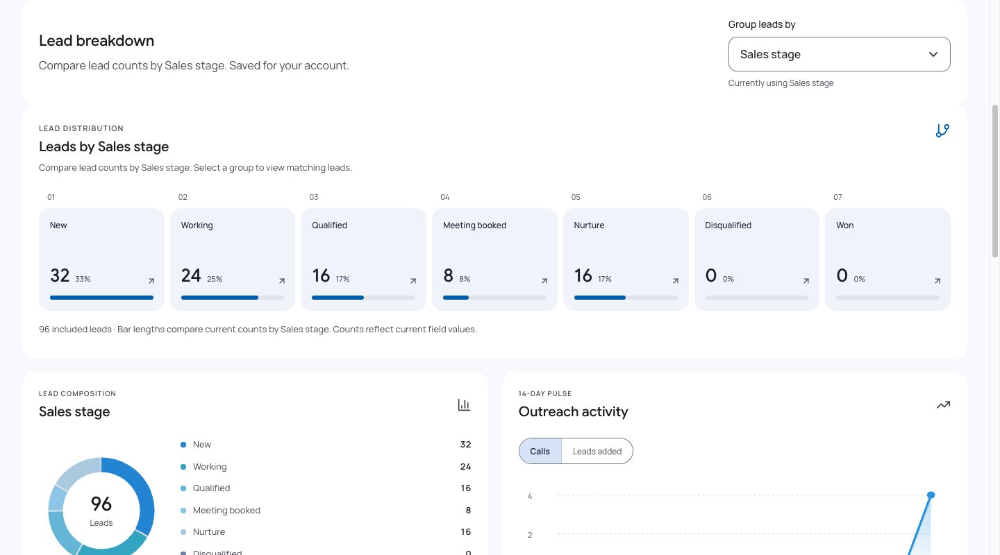
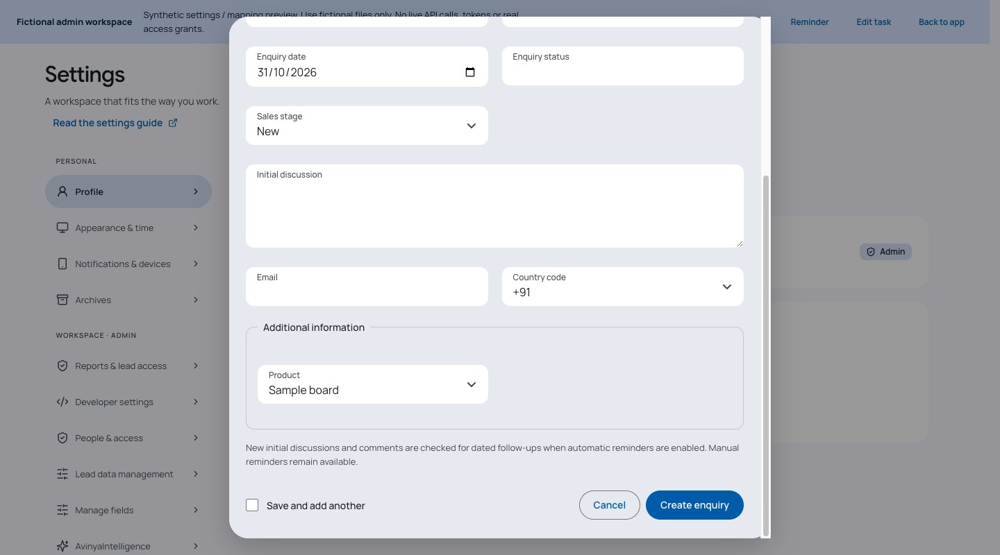

# Stage analytics and enquiry editing

Sales Stage is an explicit personal dashboard choice regardless of form hiding. Automatic still chooses the first visible category; import destinations keep their existing hidden-field restrictions. Counts show current stored stages, not historical source statuses. This release does not backfill imported stages or overwrite later edits.

PATCH permits retained shared normalized contact keys from intentionally separate enquiries; acquiring another lead's contact remains a conflict. Current scope, optimistic versions, atomic contact indexes and stage history remain authoritative.

Closed dialog selects use CSS appearance:none and the shared filled sizing/chevron; open menus remain platform-native. This prevents native closed-control sizing from collapsing Country code/custom dropdown label/value separation.

## Focused evidence

- Three selected API/grouping cases passed: shared contact stage/detail edits, new duplicate rejection/stale versions/index ownership, hidden-stage explicit choice, visible Automatic fallback and personal assigned scope.
- One real Auth/Firestore emulator case passed for persisted shared-contact stage edit, rejected duplicate acquisition and hidden-stage dashboard selection.
- Isolated Chromium synthetic dialog at 390/1440 × light/dark passed minimum control height, inset label/value separation, closed appearance and control overflow assertions. Light captures visually reviewed.
- Hidden-stage dashboard fixture selects Sales stage at 390/1440 and shows field-aware counts/copy. Both captures visually/privacy reviewed.
- Native popup keyboard selection could not be driven reliably through headless CDP (value did not change), so it is not certified. No physical-device or Safari claim. These local fixtures use no live API/customer writes and RUM is disabled.

Phone captures: [stage selection](../site/assets/screenshots/dashboard-stage-mobile-demo.jpg) and [dialog fields](../site/assets/screenshots/lead-form-selects-mobile-demo.jpg). Unchanged captures keep their original version/provenance.

Admin stage choices are read from current field configuration, not a fixed built-in list. The focused Firestore case replaces default choices, updates a shared-contact lead to Samples Given, replaces that choice with Review, then updates the lead and verifies the dashboard follows Review. Admin saves update local controls immediately; Refresh workspace reloads field configuration for changes from another session, guarded against account changes.
