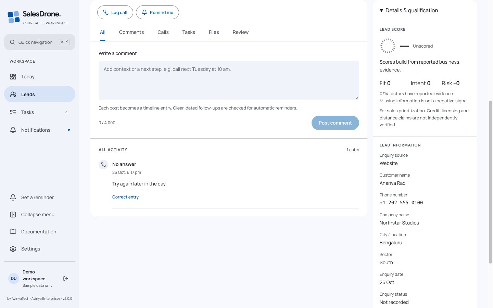

# SalesDrone testing guide

The project already has Node unit/API tests in functions/test and tests/, real Auth/Firestore/Storage integration in functions/test/emulator.integration.js, and GitHub pre/post-deployment checks. The dedicated [testing skill](../skills/salesdrone-testing/SKILL.md) and [module case catalog](../qa/test-cases.json) let a testing agent select and run them without reconstructing the conversation.

## Scripts

- `npm run qa -- quick`: unit/API tests, TypeScript, contract consistency, documentation, skills and release-plan readiness.
- `npm run qa -- integration`: actual Auth/Firestore emulator tests, using demo-salesdrone, Java 21 and free emulator ports.
- `npm run qa -- release`: all quick checks, security scan, emulator and production build. It never deploys.
- `npm test`, `npm run check` and individual `node --test <path>` commands remain useful while a release plan is incomplete.

The runner rejects unknown suite names and never executes a user-provided shell command. It stops after a failure, marks later checks not-run, and writes sanitized status/timing evidence to ignored test-results/qa-<suite>.json. CLI test output is for synthetic fixtures; JSON evidence excludes raw errors, payloads and customer data. A generated contract change must be reviewed. Production publishing stays in the authorized GitHub workflow.

## Browser recipes

Read the expected outcomes in qa/test-cases.json, then use the approved browser tool with the actual guest application. CLI success does not prove UI quality. Check 390/768/1024/1280/1440/1920px and each desktop display scale 85/90/100/110/125. Touch/narrow layouts stay100. Cover both palettes, Book mode, all font choices, long/unbroken/missing names, score null/zero/mid/100/risk, full lead/overlay navigation, drag and keyboard resizing, menus, dialogs and focus restoration. Font/scale previews apply globally only after save.

For isolated graphics, render the real ScoreBadge/ScoreRing with labelled synthetic reports; never invent a real lead's score. Expand disclosures and check counts of action sets/contact fields. Inspect complete multi-line comments and historical pagination. Save screenshots with actual viewport/scale, source commit and explicit synthetic privacy review; remove temporary Vite fixture entrypoints before build.

## API, integration and delivery

Test positive requests, unauthenticated/App Check/PAT/assigned-scope denials, stale expected versions, idempotency and transaction rollback. New personal preferences must preserve older clients and separate live identity from guest storage. The emulator suite confirms real persistence and committed audit/outbox keys. Queue existence, exporter HTTP acceptance and tenant-searchable Dynatrace data are different claims.

After authorized deployment, inspect workflow artifacts for exact live version/SHA, contract, access denial, ACTIVE function revisions, current documentation and per-signal receipts. Prefer read-only production checks and demo UI; no live leads, invitations, token creation, reminders or imports are needed for a layout test. Record failed, blocked and unexecuted cases honestly, with a reproduction and expected/actual behavior.

Current observed layout evidence is recorded in [the v1.8.0 review](UI-REVIEW-1.8.0.md).

Batch/file regression entrypoint: functions/test/bulk-and-files.test.js. Real emulator tests now include a binary round trip through Firebase Admin Storage and direct-client denial. Use an isolated temporary emulator config when default ports are in use; preserve unrelated running projects. Never use customer files as fixtures.

## Material 3 local design review

Run `npm run design:check` for focused contrast/table-presentation/entry-isolation
tests, types, local bundle build and review-fixture exclusion. It never deploys.
Use `apps/web/design-review.html` on the dev server to inspect exact viewport sizes.
The fictional admin entry is a separate local HTML page, with no API transport or
real token/device grants. See MATERIAL-3-REVIEW.md for observed versus pending UI
coverage; the unavailable browser tool is not a passed responsive screen sweep.
Full release and post-deployment suites wait for the requested human approval.

### v2 component review regressions

`npm run design:forms` server-renders the actual lead/call/reminder/task-edit and
custom-field components. It checks persistent labels, configured names, required
dates and native control/action semantics. It does not run a browser. The admin
review entry now includes isolated form dialogs with saves disabled. Manual cases
INTERFACE-MATERIAL-02 through 05 cover scrolling, composer spacing, blade action
alignment and form/dropdown geometry; execute them before approving v2.

### Infinite lead paging

Run `node --test tests/lead-pagination.test.ts` for overlapping/replayed and empty
pages plus selection preservation. `design:forms` validates the 96-record synthetic
demo fixture. Browser case LEADS-INFINITE-01 covers loading, end state, retry and
filter changes; API/emulator race verification is a separate pending integration
check. Keep page requests scoped and bounded, including empty pages with cursors.

### Approved v2 release browser evidence

The user approved v2.0.0 on 26 October 2026. Subsequent checks reused installed
Chromium with a fresh profile via localhost CDP (no package/browser installation).
See MATERIAL-3-REVIEW.md for measured widths, real observer-driven pagination,
form measurements, screenshots and explicit limits. Earlier pending notes describe
the initial review stage; current release evidence supersedes them. CI independently
runs form-render and production review-fixture exclusion checks. Never attach a
personal signed-in browser profile for these synthetic rehearsals.

## Mobile 2.0.1 local regression

`npm run review:mobile` requires the local design server and an already-installed
isolated Chromium on localhost CDP 9337. It performs trusted touch clicks on the
actual synthetic app, checks full-width lead cards (not only absence of overflow),
filter draft/apply/cancel/reset/focus, six record tabs, forms, all settings sections,
exports/imports, notifications and public Swagger. All five zoom values are saved
through the real guest preference flow. Outputs are ignored test-results/mobile*
files; do not publish these as production screenshots or physical-device evidence.

TASKS-MOBILE-2.0.1 extends review:mobile with content-width/row alignment assertions,
compact status/header checks, completion-symbol versus touch-target measurements,
all task states, Escape/outside menu dismissal and edit/reschedule/delete dialogs.
Saved zoom and theme sweeps include Tasks; mutations are synthetic in-memory only.

`node scripts/review-theme.mjs` runs the focused THEME-CONTROL-2.0.1 browser
regression against the isolated localhost CDP browser. It checks pointer/keyboard
actions, System changes, guest-local persistence, reduced motion, narrow/wide
header geometry and stored zoom/Book fixtures. Phone targets must remain >=44px;
fine-pointer controls follow the existing personal display scale. It does not
prove signed-in account persistence or physical-device/Safari behavior.

### Archives (2.1 local)

functions/test/archived-leads.test.js covers scope, pagination/cursor bindings, validation, stale versions and retained state/date/reminder cancellation. The emulator suite adds actual Auth/Firestore archive persistence and assigned paging. Local review: 22 Chromium viewport/theme cases (320–1920px), load-more 30→35 and refresh→30 using isolated AdminReview stubs. These do not certify physical devices, Safari or production. Reset tests additionally cover durable batched removal, retained configuration, locks and retry-safe recovery in memory and real emulators.

The ordinary synthetic guest app also passed archive → Settings Archives → same retained record navigation without a reload. Reset confirmation and API cleanup remain separate UI-stub and real-emulator evidence.

## Component and lint gates

`npm test` includes Vitest/Testing Library interaction tests in apps/web/test/workflows.test.tsx. `npm run test:components` runs them separately. They use synthetic records and mocked transport; jsdom does not certify viewport geometry, Safari, physical devices or production writes. Cases cover blade Escape/expand/focus restoration, desktop/mobile filter draft confirmation/cancel/reset, batch review invalidation and CSV mapping/read-only import access.

`npm run lint` checks functions/src, scripts and apps/web/src. ESLint/TypeScript errors fail CI; existing hook-dependency/accessibility findings are visible warnings with a per-file/rule regression ceiling in eslint-baseline.json. New categories or increased counts fail. Remove baseline entries as findings are fixed; do not regenerate it to accept new warnings. ESLint 9 is required by the current jsx-a11y peer range; Dependabot proposes compatible updates rather than bypassing peers.

The CI component reporter emits only hashed case identity, an allowlisted repository test path, status, bounded duration and finish time. It never sends names, assertion errors or DOM snapshots. components/lint are bounded CI labels. All testcase events remain distinct from production business operations.

## Exact match regression coverage

functions/test/exact-filters.test.js covers more than 1,000 rows, all equality predicates, assigned scope, literal Unicode/case/space differences, unchanged Equals, custom type rejection, contradictory predicates, residual conditions and cursor binding. emulator.integration.js verifies nested equality and document-ID pagination with business IDs differing from document keys. Component tests cover desktop/mobile selection. Use isolated synthetic Chromium for visual checks; jsdom is not device certification.

## Import fields and dashboard grouping

import-fields.test.ts checks populated-column coverage, blanks/comments, duplicate headers, stable ID reuse, mapping collisions and caps. Component workflows verify Admin creation with literal codes/comments and non-admin exclusion. dashboard-grouping.test.js verifies hidden-stage fallback, custom text caps/totals, empty buckets, self-owned persistence, scope, audit and old-client merging. The real emulator scenario creates schema as Admin, rejects non-admin/stale writes, imports/replays/updates custom values while preserving hidden workflow, then persists personal chart fields. Browser review covers import row hierarchy, actual open pickers, multiple widths/themes, scrolling and field switching; it does not certify physical devices/Safari.

For v2.5.0, customizable category pickers are measured open; modal selects use native platform pickers to avoid modal Escape conflicts. Measure their closed geometry and parent-dialog Escape behavior separately; do not claim CSS control over OS popup rendering.
